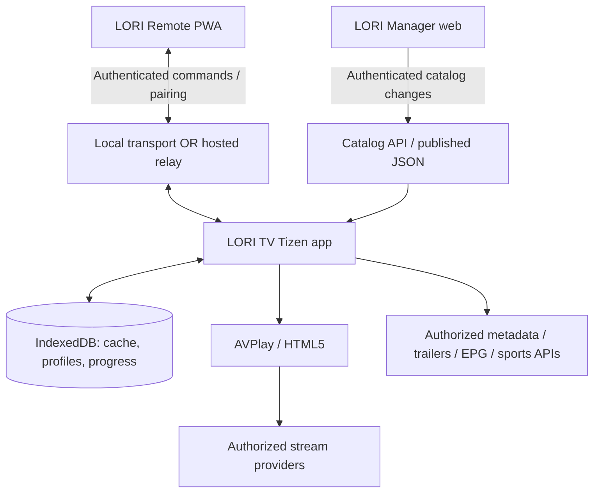

# LORI TV — System Architecture v3.5

## 1. Architectural goals
TV-first UX, remote-only navigation, direct internet playback without an always-on PC, modular source adapters, local-first state, privacy-preserving family profiles, optional remote control and catalog management, secure updates. Keep first release simple and avoid mandatory backend unless required by validated pairing/sync needs.

## 2. Context diagram


## 3. Main components
### TV client
- App shell: routing, Home default, focus graph, key handling, lifecycle, accessibility.
- Screens: Home, Live TV, Guide, Sports, Movies, Series, Search, Media Details, Player, Favorites, Watchlist, Profiles, Settings, Pair Phone.
- Catalog repository: typed unified models, category indexes, full-text search, cache versioning.
- Player adapter: capability detection, AVPlay and HTML5 implementations, stream error/retry state machine, subtitles/audio/quality controls where supported.
- Progress repository: per-profile VOD resume, recent channel shortcut, favorites/watchlist, schema migrations.
- Parental policy: content classification, PIN verification, locked profile changes, authorization checks before playback.
- Pairing client: one-time code/QR, user approval, session expiration, revocation and rate limiting.

### Remote PWA
- Pairing UI, D-pad, Back/Home, playback actions, search keyboard, speech-to-text when supported, Send to TV from indexed catalog.
- No permission to execute arbitrary TV commands. Scoped commands: NAV_UP/DOWN/LEFT/RIGHT, SELECT, BACK, HOME, PLAY, PAUSE, SEEK, SEARCH_TEXT, OPEN_CATALOG_ITEM.
- Protocol uses device/session IDs, nonce, timestamps, auth token, validation, rate limits and acknowledgements.

### Manager
- Authenticated admin; M3U parser with bounded sizes/timeouts; XMLTV parser with safe XML settings; channel-to-EPG mapping; metadata providers; source health diagnostics; revisioned publish and rollback; audit log.
- Catalog distribution can begin with signed/versioned static JSON. Manager/backend is introduced only when justified by editing/sync requirements.

## 4. Domain model
`Channel(id, name, logo, language, country, categoryIds, epgId, sourceIds)`
`StreamSource(id, channelId/mediaId, url, format, headersPolicy, rightsStatus, healthStatus)`
`EPGProgram(id, channelId, startsAtUTC, endsAtUTC, title, description)`
`MediaItem(id, type, title, synopsis, artwork, genres, year, maturityRating, playableSourceIds, trailerRefs)`
`Season(id, seriesId, number)`; `Episode(id, seasonId, number, mediaId)`
`Profile(id, displayName, avatar, isKids, maturityLimit, pinHashRef)`
`WatchProgress(profileId, mediaId, positionMs, durationMs, updatedAt)`
`WatchlistEntry(profileId, mediaId)`; `Favorite(profileId, targetType, targetId)`
`PairingSession(id, tvDeviceId, expiresAt, approvedAt, revokedAt, permissionScope)`
`SourceImport(id, kind, status, diagnostics, createdAt)`; `CatalogRevision(id, checksum, publishedAt)`

## 5. Search
Use one shared search service with scope `ALL|CHANNELS|SPORTS|MOVIES|SERIES`; normalize title and aliases, index relevant metadata, debounce UI input, return ranked matches and distinct availability status. TV remote text input and phone keyboard share the same API. Search is not a pirated-content discovery engine.

## 6. EPG
Ingest authorized XMLTV; normalize to UTC; map XMLTV IDs to channel IDs; show localized schedule; expire stale entries; handle overlaps, missing programs, timezone/DST and invalid XML gracefully.

## 7. Playback
Capability-driven adapter. Probe Tizen AVPlay for HLS/other supported formats and tracks; use HTML5 where appropriate. States: idle -> preparing -> buffering -> playing/paused -> ended/error. Cancel previous playback on channel switch. Quality and audio/subtitle menus list only supported available tracks. Never bypass DRM/geoblocking.

## 8. Pairing and connectivity
Decision gate in phase 00. Prefer authenticated LAN path only if verified on TV. If unavailable, relay over outbound secure WebSockets from TV and phone. Pairing: TV generates expiring one-time token, displays QR; phone requests pairing; TV explicitly approves; scoped session credentials; ability to revoke; prevent replay and brute force. Phone-to-TV controls only while app is open/connected. No guarantee of TV power or OS-level control.

## 9. Security and privacy
- Reject unsafe protocols and private network URLs in server-side URL fetching; prevent SSRF; strict allowlists where possible.
- No raw credentials in published catalogs, source code, browser localStorage or logs.
- Content sources require explicit rights/status and provider terms compliance.
- Admin RBAC, audit trail, input validation, import size limits, safe XML parsing, CSP, dependency scans.
- Profile PIN hashing with suitable KDF when stored server-side; on-device secret storage constraints to be evaluated; do not treat client-only PIN as strong DRM.
- Data minimization: store only needed watch history; support clearing per-profile data.

## 10. Proposed monorepo (not yet created)
```text
lori-tv/
  CLAUDE.md
  docs/{MASTER_PROMPT,ARCHITECTURE,ROADMAP,ACCEPTANCE_TESTS,UI_UX_SPEC}.md
  apps/tv/                  # Tizen React/TS app
  apps/remote/              # PWA
  apps/manager/             # authenticated web UI
  packages/core/            # domain models and contracts
  packages/catalog/         # M3U, XMLTV, search
  packages/ui-tokens/       # shared design tokens
  services/api/             # only if phase-00/manager needs it
  tests/
  scripts/
```

## 11. ADRs to decide, not assume
ADR-001: exact Samsung model, firmware, platform and developer installation.
ADR-002: AVPlay vs HTML5 playback, codecs and track capabilities.
ADR-003: phone LAN transport vs relay.
ADR-004: static catalog publication vs API/DB.
ADR-005: approved metadata, EPG, sports and legal streaming providers.
ADR-006: on-device PIN threat model and persistence.
ADR-007: TV focus navigation library vs custom.
ADR-008: content refresh/update mechanism.

`docs/ARCHITECTURE_DECISIONS.md` is the authoritative ADR register. ADR-C01/C02 are cast-specific evidence under ADR-003/002; ADR-C03 covers selected-file transfer, ADR-C04 applies ADR-006 to cast policy, and ADR-C05 records separate built-in AirPlay observations. No capability decision is approved by renumbering.

## 12. Non-goals for v1
Unlocking paid channels, DRM circumvention, scraping pirated movie websites, universal Samsung OS remote, automatic control of third-party apps, cloud DVR/recording without content rights, unsupported codec transcoding on-device.

## LORI Cast (Phase 07B): selective media handoff
LORI Remote PWA -> authenticated pairing/session transport (local channel if proven; otherwise secure relay) -> TV command router -> catalog/source authorization -> AVPlay/HTML5 playback. The phone sends a **media identifier** or a validated authorized media descriptor, not a screen recording. For phone-owned local video, feasibility-gated transfer/temporary serving is separate and must enforce explicit selection, limited scope, size/time limits, and teardown. See `docs/LORI_CAST_SPEC.md`.
No generic AirPlay receiver, mirroring, DRM circumvention, or guaranteed compatibility with Netflix/other third-party apps. Built-in Samsung AirPlay is independent of the Tizen app.


## v3.3 External Media source adapters
`CastSource = CatalogRef | GallerySelection | LocalFileSelection | ValidatedDirectMediaUrl`. Gallery and LocalFile converge into an explicit user-selected file transfer service, scoped to one paired TV and one short-lived session. Direct URL must be validated and resolved without SSRF or open-proxy behavior. TV playback capability is checked before acceptance. A PWA's browser constraints may require an approved native companion or secure relay; do not claim arbitrary iOS share-sheet support. See LORI_CAST_SPEC.md.


## v3.4 TV enhancement architecture
- `PlaybackSessionController` is the single owner of playback lifecycle and transitions. Sleep Timer uses a monotonic countdown while app is active and issues STOP on expiry; no Samsung system power-off claim.
- `ChannelNavigationService` uses ordered, playable channel IDs, D-pad and registered CH+/CH− keys when supported, and a bounded last-channel toggle. Respect parental restrictions and source availability.
- `StreamHealthService` observes player events, timeouts, buffering and failures; emits redacted status, bounded retry/backoff and optional fallback to **preapproved** alternate stream URLs for the same channel. No broad background scraping, scanning or unauthorized stream discovery.
- `MiniPlayerCoordinator` owns a single media session. It may resize/reposition a compatible video surface inside the app only after Phase 00 real-device proof. Hardware/native PiP outside LORI TV and simultaneous playback are out of scope. When unsupported, disable feature and document fallback.
- Persist per-profile sleep preference only if explicitly selected; timer active state resets on app restart. Never store unbounded telemetry or sensitive source URLs in logs.
See `docs/TV_ENHANCEMENTS_SPEC.md`.
