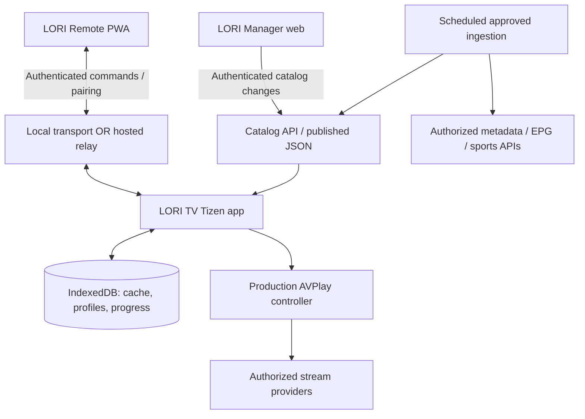

# LORI TV — System Architecture v3.5

## 1. Architectural goals
TV-first UX, remote-only navigation, direct internet playback without an always-on PC, modular source adapters, local-first state, privacy-preserving family profiles, optional remote control and catalog management, secure updates. Keep first release simple and avoid mandatory backend unless required by validated pairing/sync needs.

## 2. Context diagram


## 3. Main components
### TV client
- App shell: routing, Home default, focus graph, key handling, lifecycle, accessibility.
- Screens: Home, Live TV, Guide, Sports, Movies, Series, Search, Media Details, Player, Favorites, Watchlist, Profiles, Settings, Pair Phone.
- Catalog repository: typed unified models, category indexes, full-text search, cache versioning.
- Player adapter: Samsung AVPlay for production, capability/stream error state machine and supported tracks; no automatic HTML5 fallback. Existing HTML5 diagnostics are preserved as evidence, not changed by this decision.
- Progress repository: per-profile VOD resume, recent channel shortcut, favorites/watchlist, schema migrations.
- Parental policy: content classification, PIN verification, locked profile changes, authorization checks before playback.
- Pairing client: one-time code/QR, user approval, session expiration, revocation and rate limiting.

### Remote PWA
- Pairing UI, D-pad, Back/Home, playback actions, search keyboard, speech-to-text when supported, Send to TV from indexed catalog.
- No permission to execute arbitrary TV commands. Scoped commands: NAV_UP/DOWN/LEFT/RIGHT, SELECT, BACK, HOME, PLAY, PAUSE, SEEK, SEARCH_TEXT, OPEN_CATALOG_ITEM.
- Protocol uses device/session IDs, nonce, timestamps, auth token, validation, rate limits and acknowledgements.

### Manager
- Authenticated admin; M3U parser with bounded sizes/timeouts; XMLTV parser with safe XML settings; channel-to-EPG mapping; metadata providers; source health diagnostics; revisioned publish and rollback; audit log.
- Catalog distribution can begin with signed/versioned static JSON. Manager/backend is introduced only when justified by editing/sync requirements.

## 4. Domain model
`Channel(id, name, logo, language, country, categoryIds, epgId, sourceIds)`
`StreamSource(id, channelId/mediaId, url, format, headersPolicy, rightsStatus, healthStatus)`
`EPGProgram(id, channelId, startsAtUTC, endsAtUTC, title, description)`
`MediaItem(id, type, title, synopsis, artwork, genres, year, maturityRating, playableSourceIds, trailerRefs)`
`Season(id, seriesId, number)`; `Episode(id, seasonId, number, mediaId)`
`Profile(id, displayName, avatar, isKids, maturityLimit, pinHashRef)`
`WatchProgress(profileId, mediaId, positionMs, durationMs, updatedAt)`
`WatchlistEntry(profileId, mediaId)`; `Favorite(profileId, targetType, targetId)`
`PairingSession(id, tvDeviceId, expiresAt, approvedAt, revokedAt, permissionScope)`
`SourceImport(id, kind, status, diagnostics, createdAt)`; `CatalogRevision(id, checksum, publishedAt)`

## 5. Search
Use one shared search service with scope `ALL|CHANNELS|SPORTS|MOVIES|SERIES`; normalize title and aliases, index relevant metadata, debounce UI input, return ranked matches and distinct availability status. TV remote text input and phone keyboard share the same API. Search is not a pirated-content discovery engine.

## 6. EPG
Ingest authorized XMLTV; normalize to UTC; map XMLTV IDs to channel IDs; show localized schedule; expire stale entries; handle overlaps, missing programs, timezone/DST and invalid XML gracefully.

## 7. Playback
Capability-driven Samsung AVPlay production adapter; supported HTTPS HLS/MP4 first. No implicit HTML5 fallback. States: idle -> preparing -> buffering -> playing/paused -> ended/error. Cancel previous playback on channel switch. Quality and audio/subtitle menus list only supported available tracks. Never bypass DRM/geoblocking. Explicit Play/Watch enters immersive presentation; preparation may show a bounded loading/error overlay, never claim playback before native success. OK shows transport; Back hides visible immersive transport, otherwise Stop/Close + origin/focus/scroll. Topmost dialog closes first; Normal Player Back stops/closes. No automatic mini-player/background playback. See UI_UX_SPEC.md final Phase 01.5 contract.

## 8. Pairing and connectivity
Decision gate in phase 00. Prefer authenticated LAN path only if verified on TV. If unavailable, relay over outbound secure WebSockets from TV and phone. Pairing: TV generates expiring one-time token, displays QR; phone requests pairing; TV explicitly approves; scoped session credentials; ability to revoke; prevent replay and brute force. Phone-to-TV controls only while app is open/connected. No guarantee of TV power or OS-level control.

## 9. Security and privacy
- Reject unsafe protocols and private network URLs in server-side URL fetching; prevent SSRF; strict allowlists where possible.
- No raw credentials in published catalogs, source code, browser localStorage or logs.
- Content sources require explicit rights/status and provider terms compliance.
- Admin RBAC, audit trail, input validation, import size limits, safe XML parsing, CSP, dependency scans.
- Profile PIN hashing with suitable KDF when stored server-side; on-device secret storage constraints to be evaluated; do not treat client-only PIN as strong DRM.
- Data minimization: store only needed watch history; support clearing per-profile data.

## 10. Proposed monorepo (not yet created)
```text
lori-tv/
  CLAUDE.md
  docs/{MASTER_PROMPT,ARCHITECTURE,ROADMAP,ACCEPTANCE_TESTS,UI_UX_SPEC}.md
  apps/tv/                  # Tizen React/TS app
  apps/remote/              # PWA
  apps/manager/             # authenticated web UI
  packages/core/            # domain models and contracts
  packages/catalog/         # M3U, XMLTV, search
  packages/ui-tokens/       # shared design tokens
  services/api/             # only if phase-00/manager needs it
  tests/
  scripts/
```

## 11. ADRs to decide, not assume
ADR-001: exact Samsung model, firmware, platform and developer installation.
ADR-002: Samsung playback evidence, formats/tracks and future capabilities; production AVPlay policy is approved in ADR-005, not a new blanket native compatibility PASS.
ADR-003: phone LAN transport vs relay.
ADR-004: static catalog publication vs API/DB.
ADR-005: approved metadata, EPG, sports and legal streaming providers.
ADR-006: on-device PIN threat model and persistence.
ADR-007: TV focus navigation library vs custom.
ADR-008: content refresh/update mechanism.

`docs/ARCHITECTURE_DECISIONS.md` is the authoritative ADR register. ADR-C01/C02 are cast-specific evidence under ADR-003/002; ADR-C03 covers selected-file transfer, ADR-C04 applies ADR-006 to cast policy, and ADR-C05 records separate built-in AirPlay observations. No capability decision is approved by renumbering.

## 12. Non-goals for v1
Unlocking paid channels, DRM circumvention, scraping pirated movie websites, universal Samsung OS remote, automatic control of third-party apps, cloud DVR/recording without content rights, unsupported codec transcoding on-device.

## LORI Cast (Phase 07B): selective media handoff
LORI Remote PWA -> authenticated pairing/session transport (local channel if proven; otherwise secure relay) -> TV command router -> catalog/source authorization -> AVPlay/HTML5 playback. The phone sends a **media identifier** or a validated authorized media descriptor, not a screen recording. For phone-owned local video, feasibility-gated transfer/temporary serving is separate and must enforce explicit selection, limited scope, size/time limits, and teardown. See `docs/LORI_CAST_SPEC.md`.
No generic AirPlay receiver, mirroring, DRM circumvention, or guaranteed compatibility with Netflix/other third-party apps. Built-in Samsung AirPlay is independent of the Tizen app.


## v3.3 External Media source adapters
`CastSource = CatalogRef | GallerySelection | LocalFileSelection | ValidatedDirectMediaUrl`. Gallery and LocalFile converge into an explicit user-selected file transfer service, scoped to one paired TV and one short-lived session. Direct URL must be validated and resolved without SSRF or open-proxy behavior. TV playback capability is checked before acceptance. A PWA's browser constraints may require an approved native companion or secure relay; do not claim arbitrary iOS share-sheet support. See LORI_CAST_SPEC.md.


## v3.4 TV enhancement architecture
- `PlaybackSessionController` is the single owner of playback lifecycle and transitions. Sleep Timer uses a monotonic countdown while app is active and issues STOP on expiry; no Samsung system power-off claim.
- `ChannelNavigationService` uses ordered, playable channel IDs, D-pad and registered CH+/CH− keys when supported, and a bounded last-channel toggle. Respect parental restrictions and source availability.
- `StreamHealthService` observes player events, timeouts, buffering and failures; emits redacted status, bounded retry/backoff and optional fallback to **preapproved** alternate stream URLs for the same channel. No broad background scraping, scanning or unauthorized stream discovery.
- `MiniPlayerCoordinator` owns a single media session. It may resize/reposition a compatible video surface inside the app only after Phase 00 real-device proof. Hardware/native PiP outside LORI TV and simultaneous playback are out of scope. When unsupported, disable feature and document fallback.
- Persist per-profile sleep preference only if explicitly selected; timer active state resets on app restart. Never store unbounded telemetry or sensitive source URLs in logs.
See `docs/TV_ENHANCEMENTS_SPEC.md`.

## 13. Free-first Content Engine contract — 2026-10-28

Product policy APPROVED by user; documentation checkpoint READY_FOR_REVIEW. No implementation/hosting/workflow approved or created. This section supersedes older metadata-only watchable catalog, optional production-player choice and Phase08-only publisher assumptions. ADR-004/005/008 in ARCHITECTURE_DECISIONS.md own the decisions; no named content provider is approved merely by this design.

### Deployment and responsibilities

Scheduled hosted job -> approved provider adapters -> normalize/deduplicate -> provenance/eligibility/security validation -> signed versioned static JSON -> free HTTPS static host -> TV cache/catalog/resolver -> direct provider playback via AVPlay. No video/segments hosted, proxied or transcoded by LORI infrastructure. No paid VPS/database/streaming service, permanent application backend, custom domain purchase or always-on PC is mandatory. Free quotas/terms must be reconfirmed before deployment; exhaustion pauses publishing rather than enabling paid usage.

| Module | Publisher / TV boundary |
|---|---|
| ProviderRegistry | Reviewed provider IDs, rights evidence, API/feed/media/artwork/CDN origins, territories, languages, ads, DRM/auth requirements, quotas and expiry; public projection excludes private evidence/credentials |
| CatalogIngestion | Publisher adapters read documented permitted endpoints; bounded M3U/XMLTV/JSON parsing, stable provider IDs and explicit cross-provider matches; no title-only episode matching or website scraping |
| Metadata / VOD | Publisher enriches only linked playable media; series/season are visible only with eligible descendant episodes, episodes filtered individually; full metadata indexes may be internal, never a fake playable library |
| Channel / EPG / Sports | Channel country/language/category indexes; authorized EPG normalized UTC with versioned channel mapping; sports events linked only to verified authorized content, never infer match rights from sports category |
| CatalogPublisher | Redact, validate budgets/schema/eligibility, sign revision/control, publish complete snapshot; no per-refresh source-code commits |
| CatalogRepository | TV verifies signatures/schema/hashes/freshness, swaps a validated revision transactionally in IndexedDB; search/Home/Favorites projections share eligibility |
| PlaybackResolver | TV takes media ID, checks latest known policy, territory, validity and source contract, resolves only approved HTTPS source; no arbitrary URL lookup or secret-bearing descriptor |
| PlaybackSessionController / Health | One AVPlay session; native prepare/play/time/buffering/error evidence, redacted bounded health, authorized same-item alternatives only; no automatic unknown fallback |

### Playable-only eligibility and advertisements

Main browse/search/Home catalog contains only records with at least one approved, unexpired, currently resolvable source, allowed territory and supported target playback profile. Rights and technical eligibility are independent gates. Public URL, metadata availability and HTTP 200 prove neither rights nor native playback. Publisher parses the actual allowed playlist/file description and bounded media checks; AVPlay support must have real Samsung evidence for each enabled provider/format profile. Per-source device status stays UNKNOWN until actually tested; profile evidence does not falsely mark every URL DEVICE PASS. Eligibility is a timestamped snapshot, not a guarantee the network remains available after listing.

At display/use, exclude known failed, expired, revoked or region-ineligible sources; recheck the selected source before Play. A native failure immediately removes the watchable projection and offers a clear unavailable/Retry state; no fake Play or silent source substitution. Saved references/progress may remain as disabled unavailable records outside the watchable catalog. No manual playlist/URL entry is required; developer-approved registry/bootstrap is bundled. Global country/language/category models are required, but no promise of universal/free premium coverage or a minimum rich-catalog count before providers are approved.

No LORI-injected ads, ad pop-ups, redirect-based web playback, untrusted embedded players or third-party tracking scripts without separate approval. Original provider ads are acceptable and must not be stripped/bypassed; show provider-ad disclosure. Validated HTTPS CDN redirects are transport, not ad-page navigation, and every destination remains allowlisted. Artwork, EPG, metadata and video each require their own usage/publication rights. Personal use alone grants no integration/redistribution rights.

### Versioning, publication and cache safety

Logical contract (not generated files): a small signed control document contains schema version, monotonically increasing policy sequence, current revision/digests, issuedAt/validUntil and revoked provider/source IDs. Immutable content-addressed revisions contain bounded channel/media/EPG shards and attribution; source records include provenance ID, rights status/review expiry, territories, format/codecs, auth/DRM policy, lastResolvedAt, source validUntil and native evidence reference. Never publish bearer URLs, API keys, cookies or credentials. Public URLs may be published only when the provider permits it; no protected data on static hosting, even if its source repo is private.

Build/validate in a temporary runner workspace; publish a complete static-site artifact/deployment containing the control document, current and at least two retained eligible revisions, without committing generated output. Export only an explicit inventory of public catalog/control/shard/attribution and permitted artwork files, never the whole repository, runner workspace or raw inputs. Publish only changed content; refresh signed validity/control when necessary. Verify deployed bytes before accepting a publish. One writer/concurrency lock prevents older jobs overwriting newer policy. Cross-CDN atomicity is not assumed: clients fetch control then referenced immutable shards, verify every digest/signature and commit only a complete matching revision. A mixed/partial deployment never replaces last-known-good. Source artifact retention is bounded and must not be the sole persistent rollback store; re-fetch/revalidate the active site before producing the next deployment.

On rollback, publish a NEW higher policy sequence pointing at an older compatible catalog after current rights/expiry/revocation filtering. TV retains the highest policy sequence and known tombstones; an older site deployment cannot re-enable a revoked source. If current control cannot be validated, do not ignore tombstones or extend source validity. Integrity signatures use an independent future catalog signing key in CI secret storage and public verification key on TV; never reuse Tizen signing certificates. Algorithm/key rotation/target signature-API support remain implementation gates; no key is generated now.

### Refresh, outage and initial resource budgets

These are measurable initial design targets to validate in Phase03A, not measured performance or hosting guarantees:

- Publisher every six hours, offset from top-of-hour; optional operator-triggered urgent publish/revocation. No manual TV playlist configuration. Repository inactivity and missed schedule must be observable; no dummy keepalive commits or reliance on an operator PC.
- TV checks control at startup/resume and every 15 minutes while foreground/online, using conditional requests; retry backoff is capped at 10 minutes and individual requests timeout within 10 seconds. Host control cache age target <=10 minutes; do not assert this is configurable on GitHub Pages without endpoint evidence. The acceptance target is known revocation applied within 30 minutes of a successfully published control while TV is online; if cache behavior cannot meet it, choose the configurable alternative or revise with approval before deployment. No immediate/offline-revocation guarantee.
- Hard freshness lease <=24 hours from publication, further bounded by provider/source rights and URL expiry. Cache metadata may remain browsable as unavailable after that lease, but new playback is disabled. Last-known-good may play only while still authorized, not revoked, within validity and technically resolvable. An expired/known-revoked active session is stopped through the controller; delayed discovery during outage cannot be eliminated by static hosting. Clock rollback/unreliable time fails closed for time-sensitive playback.
- EPG rolling next 48 hours, refresh six-hourly where licensed/within quotas; expired shows removed independently. Metadata refresh daily with IDs/artwork/source mapping kept revision-consistent. Missing EPG shows no-programme information, never fabricated data or loss of an otherwise eligible channel.
- Budget initial dataset <=1,000 channels and <=500 VOD/episode records, no guaranteed count; control <=256 KiB, individual JSON shards <=2 MiB, total deployed snapshot <=50 MiB, active TV catalog/EPG cache <=20 MiB. Paginate/lazy-load and evict metadata/artwork without deleting profile progress. These are caps, not promises to source that much content. Host no media, and only licensed essential artwork; prefer permitted provider artwork CDN.
- Limit each scheduled run to 10 minutes, max two concurrent upstream requests, at most two retry attempts per transient operation with bounded backoff/jitter and Retry-After. Provider-specific lower quotas override defaults. Never retry authorization/geo failures automatically. A failed feed cannot silently renew old source verification/rights; continue only until its existing lease expires. Exceeding size/time/quota fails the candidate publish, preserves last-known-good and reports health. Monitor stale generatedAt on TV and CI failure notifications; a never-triggered schedule may not send a failure notification.

### Free hosting comparison and recommendation

Official documentation checked 2026-10-28. Figures are provider limits, not capacity purchased or account settings verified. Terms can change; no SLA or perpetual free tier is assumed.

| Option | Free-tier suitability | Exposure, caching and operational tradeoff |
|---|---|---|
| GitHub Actions + GitHub Pages | Recommended initial candidate for a small personal public catalog: Pages on GitHub Free requires a public repo; published site <=1 GB, bandwidth soft limit 100 GB/month; commercial SaaS use is restricted | Custom Actions artifact deployment avoids catalog commits. Pages is public; only data permitted for republication. HTTPS available; response headers/CORS/cache and Tizen origin behavior must be measured; cannot rely on arbitrary custom headers |
| GitHub Actions + Cloudflare Pages Free | Suitable alternative: 500 builds/month, 20,000 files, 25 MiB/asset; static requests are free/unlimited within service terms | Direct Upload supports prebuilt output without Git commits; separate account/project/deploy secret required. Configurable static headers and ETag revalidation suit control freshness. Public production/preview deployment URLs are not a rights boundary. Same Actions scheduler weaknesses remain |

Both alternatives still need approved provider quotas/rights. Standard hosted Actions is free for public repos; GitHub Free private repos have 2,000 minutes/month and 500 MB artifact allowance. Four ten-minute runs/day are up to 1,240 minutes in a 31-day month before other jobs/retention: budget is shared, not reserved. Never enable larger runners, paid add-ons or unbounded artifact retention. Public workflows/logs/artifacts and site output can expose data despite secret masking; allowlist exported fields, no raw provider payloads, redact logs, least-privilege trusted jobs with no secret-bearing untrusted PR runs.

Actions schedules can be delayed/dropped, run from default branch and public schedules disable after 60 days without repository activity. Do not promise unattended indefinite freshness; display stale state, require maintenance/re-enable when necessary, and fail closed on lease expiry. Cloudflare hosting alone does not solve scheduling; a different scheduler/serverless extension would require separate evaluation/approval.

Recommendation is conditional, not a provisioned host decision: use Actions/Pages if public-data permission, terms, quota, HTTPS/CORS/cache/revocation tests pass; prefer Cloudflare Pages if header control is needed. At four routine publishes/day (~124/month), either is plausible; emergency/other deployments also count and Direct Upload accounting must be reconfirmed. No cloud resources, accounts or workflows are created by this checkpoint.

Sources: [GitHub Pages limits](https://docs.github.com/en/pages/getting-started-with-github-pages/github-pages-limits), [Actions billing](https://docs.github.com/en/billing/concepts/product-billing/github-actions), [Actions schedule](https://docs.github.com/en/actions/reference/workflows-and-actions/events-that-trigger-workflows#schedule), [Pages artifact deployment](https://docs.github.com/en/pages/getting-started-with-github-pages/using-custom-workflows-with-github-pages), [Pages HTTPS](https://docs.github.com/en/pages/getting-started-with-github-pages/securing-your-github-pages-site-with-https), [Actions secrets](https://docs.github.com/en/actions/how-tos/write-workflows/choose-what-workflows-do/use-secrets), [Cloudflare limits](https://developers.cloudflare.com/pages/platform/limits/), [static pricing](https://developers.cloudflare.com/pages/functions/pricing/), [Direct Upload](https://developers.cloudflare.com/pages/get-started/direct-upload/), [headers](https://developers.cloudflare.com/pages/configuration/headers/), [ETag/cache](https://developers.cloudflare.com/pages/configuration/serving-pages/).

### Optional backend and migration gate

Providers requiring private data, server-side per-user authentication/entitlement, secret-bearing short-lived playback authorization or stronger real-time revocation are excluded from static MVP. An optional minimal backend/resolver may later satisfy those needs only with separate cost/security/provider approval; no credentials may be baked into JSON as a workaround. No DRM, authentication, region or ad bypass. Keep CatalogRepository/ProviderRegistry/PlaybackResolver contracts and IDs independent of host: base HTTPS endpoint and trusted keys are approved configuration, adapters normalize the same records, and migration preserves schema/rights/focus/UX. A new host needs CSP/origin/TLS verification and possibly an explicitly approved app configuration update; no automatic trust of a remote-specified host, paid failover or media proxy. Existing HTML5 diagnostics/preview remain untouched.


## 14. Phase02 M3 local input/focus/navigation — 2026-10-30

M3 accepted/completed for confirmed physical navigation scope on 2026-10-31; package/deployment and user physical evidence are recorded in HANDOFF and ACCEPTANCE_TESTS. Optional keys, physical repeat timing, explicit exit/relaunch, quantified overscan/readability and soak remain PENDING. This updates acceptance evidence only; architecture unchanged. Implemented under explicit M3 authorization. Four vanilla-TypeScript modules in apps/tv/src: input/remote-input.ts (one disposable normalized event owner), input/tizen-keys.ts (isolated optional platform calls), focus/focus-manager.ts (explicit graph/scopes/anchors/scroll), navigation/navigation-stack.ts (bounded origin snapshots and ordered Back). No geometric neighbor search, focus framework, router runtime or new dependency. M2 frame/tokens/localization/preferences preserved; old pc-navigation.ts retained as inactive M2 reference and not imported into runtime.

Mandatory PC/TV arrows/Enter/Back normalize to typed actions, with keyup-bound one-shot suppression, reentrancy protection and100ms directional-repeat throttle. Native editing/composition and unconsumed media retain their defaults. Focus uses stable IDs/regions, eligible explicit neighbors and remembered content anchors; missing/disabled/hidden/inert/disconnected controls resolve to scope fallback. Dialog scopes trap focus; snapshots restore focus and scroll, then clamp only as needed for visibility. Registry32 scopes,256 nodes/scope and8 nested scopes; history32 entries rejects overflow rather than losing the root. Mutation/lifecycle reconciliation and disposer hooks prevent stale focus/listeners.

Home remains the only implemented screen. Existing preference controls open app-owned, localized choice dialogs for remote OK; pointer/change compatibility remains. Full/Standard + Menu persist, selection and focus remain visually distinct. Root Back opens Cancel-first confirmation; Menu/modal consumes Back before history,450ms Back guard coalesces bursts. History stores screen/focus/scroll/state and rolls back if restoration throws. Synthetic nested screens are tests only; real content routes remain later work. A future Player entry is blocked from push/pop/replace/Back unless an injected leave guard confirms release; no player or session is implemented. Later immersive visible-controls dismissal and Stop/Close origin contract remain authoritative.

No optional-key requirement currently exists: configureOptionalKeys receives no requested keys, does not call getSupportedKeys/registerKey and needs no tv.inputdevice privilege. Adapter supports bounded, allowlisted discovery/registration only with explicit future request+approval; unsupported API/errors leave mandatory navigation usable. Media/color actions have no active consumer and are not captured in this frame. Menu always has an on-screen alternative. Home/volume/power and system long-Return remain OS-owned. Explicit confirmed Exit alone may call isolated getCurrentApplication().exit(); PC absence/failure leaves a cancelable error, never a false success.

Historical local-only evidence (2026-10-30):46 Node tests PASS (18 previous +28 M3),22 XMLDSig security assertions PASS,3×1000 deterministic stress actions PASS,50 input-owner install/dispose cycles PASS;12 browser cases PASS before signing/deployment. Accepted physical navigation and signed deployment now recorded above and in HANDOFF; optional hardware, repeat calibration and quantified overscan/readability remain PENDING. FREE-FIRST contracts unchanged; M4–M6 NOT STARTED.
