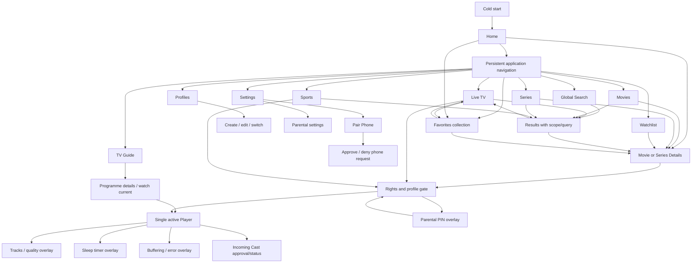

# LORI TV — UI/UX Specification v3.5 (Phase 01 closure baseline)

## Scope and visual source of truth
The `mockups/tv/` (18 PNG), `mockups/remote/` (9 PNG), and `mockups/manager/` (8 PNG) folders contain **35 individual conceptual screens** (31 base screens plus four Cast concepts). Two additional overview boards bring the total to **37 PNGs**. These are design references, not functioning apps or evidence of content rights. `mockups/LORI_TV_All_Interfaces.png` is the earlier broad mood board. The individual screens are more authoritative for navigation/layout. If a sample channel/movie appears, it is placeholder content only.

## Visual direction (concrete closure tokens below; calibrate on real TV)
- Target composition: 1600×900 design artboard, scaled to TV resolution; support 1920×1080 and Samsung safe-area/overscan.
- Background `#07101e`; side panel `#081322`; surface `#111f32`; borders `#2b425d`; primary `#1672ed`; text `#f1f6ff`; muted `#9db0c6`; success `#69e3a2`.
- Typography: system sans fallback. TV base 18–22px at 1600px design width; headlines 42–60px; never depend on hover or tiny text.
- Focus: blue outline with visible high-contrast halo; single deterministic focus target; no keyboard trap; Back returns to previous logical focus.
- All controls: focusable, readable, no off-screen focus, labels exposed; avoid autoplay video on Home.
- Motion: subtle, reduced motion option; poster loading skeletons; placeholders on errors.

## Global TV navigation
Persistent sidebar: Home / Live TV / TV Guide / Sports / Movies / Series / Search / Favorites / Watchlist / Profiles / Settings. Header may expose Search and active profile. On cold start, always route to **Home**. Continue Watching resumes VOD position only when explicitly selected; recent live channel appears as shortcut, not automatic playback.

## TV screen-by-screen behavior
| File | Screen | Required behavior |
|---|---|---|
| 01_home | Home | featured catalog item, Continue Watching, recommendations, favorites, visible empty states |
| 02_live_tv | Live TV | per-category search, filters, selected channel, player preview, favorites, loading/error states |
| 03_tv_guide | TV Guide | now/next, day selection, UTC-to-local timezone/DST, missing schedule placeholder |
| 04_sports | Sports | schedule, live/upcoming/results, sport filters, link to authorized source only |
| 05_movies | Movies | category-only search, genres, catalog cards, availability labels |
| 06_series | Series | category-only search, genres, series cards |
| 07_search | Global Search | ALL/CHANNELS/SPORTS/MOVIES/SERIES, debounce, suggestions, keyboard |
| 08_search_results | Results | query preservation, zero results, loading, filter chips, availability |
| 09_movie_details | Movie Details | metadata, trailer (if permitted), play only if source allowed, watchlist |
| 10_series_details | Series Details | season selector, episodes, resume, next episode |
| 11_player | Player | play/pause, seek where allowed, progress, buffering, failure/retry |
| 12_player_settings | Playback settings | available subtitle/audio tracks, quality options conditional on stream |
| 13_watchlist | Watchlist | per-profile entries, remove, filter, unavailable indicators |
| 14_profiles | Profiles | create/switch, kids profile, guest, local profile boundaries |
| 15_parental_controls | Parental Controls | parent approval, PIN gate, age classification, deny unknown-rated by policy |
| 16_settings | Settings | language, quality, storage, sources, pairing, diagnostics |
| 17_pair_phone | Pair Phone | QR/code expiry, TV-side approval, revoke, errors |

## LORI Remote mobile screen behaviors
1. Pairing: temporary QR/code, expiry and TV confirmation. Do not put long-lived secrets in QR.
2. Remote: D-pad, OK, Back, Home, play/pause; only controls LORI TV, not Samsung OS.
3. Keyboard Search: send normalized search text and selected result; scoped search modes.
4. Voice Search: explicit microphone consent, speech-to-text when supported, graceful fallback.
5. Send to TV: open only a catalog ID, verify permissions on TV, no arbitrary URL playback.
6. Remote Settings: connected devices, revocation, diagnostics, privacy.

## LORI Manager web screen behaviors
Dashboard, Channels, Source Imports, EPG Mapping, Movies & Series, Profiles, Settings, Audit Log. Manager must be authenticated, role-authorized, audit-logged and never expose raw stream credentials in public catalog.

## Search contract
Each category has a clearly visible Search action. Movies search only MOVIES, Series only SERIES, Live TV only CHANNELS, Sports only SPORTS; global search ALL. Show debounce, empty/error/loading and recent queries scoped to active profile. Search catalog items only, never promise universal Netflix/MyFlixer discovery.

## Design acceptance checklist
- Screens visually reviewed on 16:9 TV and narrow phone; text readable from sofa.
- D-pad paths and initial/return focus specified per screen; Back/Home behavior consistent.
- Loading/empty/error/offline/parental-locked/no-source states designed for all data screens.
- No fabricated streaming entitlements or live sports results in production.
- All 35 individual PNGs are **conceptual**; component states, focus maps, responsive adaptation and final branding need implementation validation.

## LORI Cast screens and behavior
Phone: `Cast to LORI TV` action on playable catalog items; Cast Picker (paired TV, connectivity, selected title), Casting (poster/title, progress, pause/seek, stop), Unsupported/Expired Source error. TV: compact incoming cast confirmation/status overlay, then player; Back exits playback without exposing phone content. Pairing and parental PIN policies remain enforced. Never depict or request full-screen capture or notifications. Four dedicated Cast concept PNGs already exist; see `MOCKUP_INDEX.md`. Gallery/Files/Video URL input and transfer-state designs remain pending.

## v3.3 — LORI Cast external media UI
From LORI Remote > Cast: show **Gallery**, **Files**, **Video URL** as three distinct entry points. Gallery/Files open user-initiated pickers, show filename, size, preview when possible, device picker, transfer progress, Play/Stop. Video URL has editable URL input, clear unsupported-webpage explanation and error states. Never show or transmit notifications or other phone content. Add dedicated mockups before implementing these screens; previous Cast mockups cover pairing/playback/errors/TV confirmation only.

## v3.4 — Additional TV UI states (mockups pending)
- **Sleep Timer:** Player > More > Sleep Timer; Off, 30, 60, 90 min; remaining time and cancel confirmation; clear that it stops LORI TV playback, not television power.
- **Channel Zapping:** brief unobtrusive channel name/logo/Now-Next overlay after CH+/CH−; last-channel toggle; D-pad fallback if hardware keys unavailable; preserve focus.
- **Stream Health:** subtle buffering status, retry progress, offline/error state and manual retry; never expose raw stream URL or secrets.
- **Mini Player/PiP:** optional future in-app enhancement only after capability/stability approval; excluded from initial Phase02. Never automatic on Back and never a system-wide PiP promise.
- Dedicated reference mockups for these four screens are **PENDING**, not part of the current PNG count.

## Phase 01 review draft — 2026-10-27

Status: written specification finalized for closure review; primary decisions approved on 2026-10-27. Final closure approval and Phase 02 execution remain gated. User authorization covers planning only. Baseline main / 1a2a71ff2982cd7b4a35f43e6efc13535d5e0de2. All 35 individual PNGs and both overview boards visually inspected; no mockup or diagnostic source changed. The following maps are written interaction specifications, not implemented behavior; the closure section below records approved decisions and supersedes old proposals. Existing product requirements remain authoritative. Architecture, deferred feature policy and hardware claims remain pending where explicitly marked; do not infer accepted ADRs from specification text.

### Review findings and precedence

- All 17 numbered TV screens plus cast_incoming share the navy/blue direction. They do not specify a complete focus graph, every modal or a production state machine.
- The 8 Manager PNGs show selected navigation and literal blank content placeholders. The broad overview contains dashboard examples, but cannot substitute for approved detailed Manager layouts. Categories appears in Manager navigation without a dedicated PNG.
- The 9 Remote PNGs cover pairing, remote, keyboard, voice, catalog send, settings and 3 Cast concepts. Gallery/Files/URL selection, transfer, cancellation and cleanup views remain undrawn. Cast artwork depicts content/4K/language choices illustratively, not entitlements or tested capabilities.
- Favorites has an approved dedicated sidebar route plus relevant Home/Live TV sections. It has no standalone PNG yet. Watchlist is distinct; D01 is resolved by the user.
- Live TV shows a preview while Home forbids autoplay. Focus alone must never start a stream; explicit selection may start a supported preview under one-session ownership. Preview-to-player behavior is specified in the closure section.
- Settings depicts an editable Startup page; the invariant is always Home. Specify a read-only Home value, not a configurable alternative. Profiles never replace Home on cold launch; profile selection can open from Home.
- Search results omit Sports in the pictured chips although the text contract requires SPORTS. Keep all five global scopes; do not derive missing product features from a concept image.
- Player artwork includes sidebar, speed, quality and subtitle choices. These are conditional capabilities, not a promise to expose all controls or keep decoding during navigation. No automatic HTML5 fallback is implied by a mockup.
- Pairing approval is required; ongoing cast confirmation policy is unresolved under ADR-C04. Cast incoming artwork is a post-start status card, not evidence of a safe pre-play approval flow.

### Screen inventory and navigation graph

Route identifiers below are specification labels, not existing routes or a mandated router library. Every content entry carries a return token: origin route, profile, query/filter, item ID and scroll/focus anchor. Resolve missing anchors to nearest remaining item, then section action, then active sidebar item.

Scope-specific results use the same results component with CHANNELS/MOVIES/SERIES/SPORTS locked; global results allow ALL plus the four scopes. A channel result opens its Live TV context; an event opens event information and only offers an authorized source when available; movie/series results open details. A future programme is information, not a fake play action. Back uses the captured origin rather than inventing a route hierarchy.

### Samsung remote and focus contract

- One logical focus at a time. Selected sidebar/category and keyboard focus have distinct styling. Cards do not activate on focus. Stable IDs survive virtualization, sorting and async updates.
- Sidebar Up/Down moves one item, clamped at ends; OK navigates; Right restores the route's content anchor. Left at the sidebar stays there. Content Left at its leftmost boundary enters active sidebar; Back does not stand in for Left.
- Rails: Left/Right one card, Up/Down nearest column in adjacent nonempty rail; grids: horizontal/vertical neighboring cell, clamp at boundaries. Preserve column intent in shorter last rows. No wrap by default; a row of one item is still navigable vertically.
- Header Search/Profile controls form an explicit region above content. Up from first content region enters header; Down returns its remembered anchor. Do not let auto-scrolling conceal the focused control.
- OK activates on initial press; held OK/Back must not trigger duplicate commands. Directional repeat moves through visible logical items without triggering network requests. Repeat timing is an implementation parameter to calibrate, not a new hardware test in this phase.
- Back priority: dismiss active input/topmost modal; in immersive Player dismiss visible transport overlay without stopping, otherwise Stop/Close + origin; in Normal Player Stop/Close + origin; outside Player dismiss navigation overlay before route history/exit confirmation. The Phase 01.5 final interaction below supersedes the earlier uniform Player Back rule. Cancel is default for exit/destructive dialogs; Samsung Home/volume remain OS-owned.
- Physical Home remains owned by Samsung. An in-app Home action uses the same safe Stop/Close barrier before navigating Home if playback is active. Media keys/CH keys are optional accelerators with visible remote-only alternatives; do not promise availability from prior arrow-key tests.
- When an active item disappears, move focus deterministically and announce the changed state. During loading keep navigation/Cancel reachable; skeletons are not focus targets. An error cannot trap Back.
- Overlay focus is constrained to its controls; closing restores the invoking control. Background controls cannot activate. Playback menu default focus is the current supported choice; destructive/approval menus default to Cancel/Deny.
- Window/app return restores the current valid focus anchor. Lifecycle playback behavior belongs to the player controller; no automatic resume promised. System Home/Back sequencing and modal focus need later shell/device validation.

### Per-screen focus maps

All rows inherit the preceding contract. I = initial entry target; arrows define region transitions as well as child movement; return means restoring the origin anchor, never resetting every screen to item 1.

| Screen / reference | I and arrows | OK / primary transitions | Back and restoration |
|---|---|---|---|
| Home / 01 | I=first enabled hero action; hero Left/Right actions; Down Continue Watching, then recommendations/favorites rails; Up header | Detail/Explore opens relevant catalog; Continue Watching opens authorized resume explicitly | Home root opens exit confirmation; cancel restores hero/card |
| Live TV / 02 | I=channel Search; Down category row then list; Up/Down channels; Right preview actions; Left list/category then sidebar | Focus updates info only; explicit OK selection may prepare a supported preview; explicit Watch opens the same single session in Player; Favorite toggles with feedback | Preview actions -> originating list anchor through Left; Back route history; leaving Live TV stops/closes active preview; no hidden background playback |
| Guide / 03 | I=current programme in remembered/first channel; Left/Right time cells; Up/Down channels preserving time; top day selector | Current item opens programme panel with Watch; future item information only; no-source explains | Close panel to same cell; Back origin route; stale EPG preserves channel/time anchor |
| Sports / 04 | I=Upcoming/active tab; horizontal status/sport filters; Down event rows; Right row action | Event information -> authorized channel/player only when valid | Details -> event anchor; Back route history; no availability inferred from live badge |
| Movies / 05 | I=scoped Search; Down genres then rails/grid | Movie card -> Movie Details; View all preserves genre/filter | Detail return restores card/scroll; Back history |
| Series / 06 | I=scoped Search; genres/rails as Movies | Series card -> Series Details | Same return behavior as Movies |
| Global Search / 07 | I=query input; keyboard explicit on OK; Down scopes, suggestions, results | Text updates catalog results; select scope/item; phone input uses same state | Back closes keyboard first, preserves query; next returns origin |
| Results / 08 | I=first result or zero-results action; Up scopes/query; grid navigation | Channel/event/movie/series use destination rules above | Restore query, scope and selected item when returning; Back search/origin |
| Movie Details / 09 | I=Play if allowed, otherwise first available Trailer/Watchlist action; horizontal actions; Down related rail | Play gates rights/PIN; permitted Trailer uses same one-player owner; Watchlist per profile | Return origin card; no automatic trailer/hero playback |
| Series Details / 10 | I=Resume/Play episode if allowed, else season; Down season then episode list; Up/Down episode, Left/Right available actions | Season opens option list; episode -> gate/Player; next episode requires explicit choice pending D07 | Season popup -> selector; Player return -> exact episode; Back origin |
| Player / 11 | Direct immersive entry; OK reveals temporary controls with Play/Pause focused; directional control navigation | Seek only if supported; tracks -> 12; explicit Stop; overlay Fullscreen/Exit Fullscreen preserves session | Immersive visible controls consume Back; hidden controls -> Stop/Close + origin; Normal Player Back -> Stop/Close + origin; VOD progress only |
| Playback settings / 12 | I=current supported subtitle/audio/quality; Left/Right columns, Up/Down options | Choose available track/Auto; show current selection separately from focus; absent options show reason | Back closes to invoking player menu; not global Settings |
| Watchlist / 13 | I=first saved card, empty=Browse; Up filters; cards/actions separated | Open details; remove explicit action/confirmation, choose next surviving card | Back history, preserve filter; profile switch invalidates prior profile data |
| Favorites / no PNG | I=first favorite or Browse channels; list/grid same as Live/catalog | Open saved target; explicit remove restores nearest item | Dedicated Favorites route plus Home/Live TV entries approved; restore origin/filter/scroll; per-profile data distinct from Watchlist |
| Profiles / 14 | I=active profile; horizontal avatars; Down Manage | Switch through PIN policy; Add/Edit -> name/avatar/kids editor; cancel non-destructive | Return prior route with new profile-safe content, never inherit restricted history |
| Parental / 15 | I=PIN gate Cancel before entry; keypad deterministic 3 columns plus zero/delete/cancel; settings list after auth | Confirm verifies; settings toggle/rating choice requires authorization; no PIN logging | Cancel returns invoker without granting access; retries/lockout/reset policy pending D06 |
| Settings / 16 | I=General first actionable row; Left/Right panels; Up/Down rows | Language/quality/storage/source/device subpanels; startup Home read-only; destructive clear confirmation | Close subpanel -> row; Back origin; never clear on focus |
| Pair Phone / 17 | I=Cancel/Back until request; QR/code display nonfocusable; request -> Deny/Approve | Explicit approve only valid unexpired request; Regenerate explicit; connected devices -> revoke | Cancel invalidates pending request then restores Settings row; expiry cannot leave stale Approve |
| Cast incoming / cast_incoming | I=Deny/Cancel in proposed pre-play modal; Left/Right choices; status after acceptance | Gate pairing, source and parental policy before transfer to Player; Stop explicit | Deny preserves current session; acceptance/replacement policy pending D08 |
| Sleep timer / missing PNG | I=current Off/30/60/90 option; Up/Down options; remaining timer + Cancel | Set/extend/cancel explicit; expiry stops in-app playback only | Close to More; pause/suspend/restart/countdown policy requires D09 |
| Zapping overlay / missing PNG | Passive Now/Next does not steal focus; visible Prev/Next/Last controls when opened | Registered CH keys or on-screen controls request single-channel transition | Close overlay restores Player; unsupported keys do not remove controls |
| Stream health / missing PNG | Passive connecting/buffering no focus theft; terminal error I=Retry or Back | Explicit Retry, Stop/Back; any automatic retry budget pending D10, no fallback discovery | Back cancels request and returns origin; retain redacted reason |
| Deferred optional mini-player / missing PNG | I=Expand when explicitly entered; Left/Right Expand/Close; route navigation separate | Expand returns same session; Close stops same session, no second player | Not part of Phase01 implementation or initial Phase02 shell; optional future explicit entry only after feasibility/approval; never Back-triggered |

### State matrix and data boundaries

| Surface | Loading / refresh | Empty / unavailable / locked | Error / offline / stale | Navigation and playback states |
|---|---|---|---|---|
| Home, Movies, Series | Nonfocusable skeletons; keep shell interactive; do not reorder focused items on refresh | No Continue Watching rail until entries exist; no catalog -> source/help action; no-source cards retain metadata label | Cached last-known-good with timestamp/offline label; first-load failure -> Retry/Settings/Back | No autoplay; content rights checked again on activation |
| Live TV / Favorites | Channel list and stream preparation distinct; logo placeholder | Empty categories/filter/favorites each distinct; restricted channel shows safe PIN gate; unknown classification follows D06 | Source unavailable != empty list; user-visible manual Retry; old request cancelled on channel change | Selected channel != focused channel != playing channel; no focus-triggered zapping |
| EPG | Schedule loading independent of channel list | No data says schedule unavailable; past/future programmes are not playable unless separately authorized | Timezone/DST local display from UTC; stale badge, overlapping/missing data bounded | Return anchor channel ID + time; info panel includes interval and source availability |
| Sports | Loading schedule/results separately from playback availability | No events for date/filter; event exists without stream -> information only | Provider unavailable/stale scores explicitly labeled; never fabricate results | No watch action solely because event is live |
| Search / Results | Proposed 250ms debounce; cancel/discard stale requests; parameters profile/query/scope | No query -> recents/suggestions; zero matches -> clear/edit; no permitted source != no metadata | Preserve query on error; offline cached results labeled; no automatic internet-wide search | Caret arrows stay in text editing until keyboard dismissed; restore scope/result anchor |
| Details / Episodes | Placeholder artwork and metadata; episode page loading isolated | Missing artwork fallback; no playable source -> reason and nonplay actions; locked synopsis/artwork follows privacy policy | Metadata failure Retry/Back; expired source revalidate on explicit Play | Per-profile progress; no autoplay trailer or next episode |
| Player / menus | preparing -> buffering -> playing/paused -> ended/error; indicate elapsed wait without exposing source URL | No tracks/quality support shows unavailable reason; ended offers Replay/Back and explicit next episode | Manual recovery and stop; preparation timeout remains visible; later stability phase tests recovery, TLS/network changes and soak | One active decoder/session; menus preserve position; return never creates duplicate audio |
| Watchlist / Profiles | Refresh entries after profile change; stable IDs | Empty Watchlist -> Browse; failed profile switch leaves original profile active | Save/remove failure preserves prior state and offers retry, not optimistic permanent success | Removal focus nearest surviving card; cancelling edits restores invoker |
| Settings / Parental | Saving indicator and persisted-state acknowledgement | Unsupported preference read-only reason; locked controls cannot alter state | Storage full/corrupt/error -> recoverable view; clear data only confirmed; PIN values masked | Startup Home invariant; sign-out/clear/revoke distinct from Back |
| Pair / Cast | request pending, awaiting TV approval, connecting, preparing, playing, stopping | expired/revoked/wrong-TV/request-denied; unsupported format shown safely | interrupted transfer/connection with explicit retry/cancel; no auto switch to other TV/source | Cancellation aborts pending work; file cleanup status explicit; phone notifications never transmitted |

State labels are orthogonal: focus, selected filter, authorization, playability and network/player state must not share one misleading PASS color. Disabled choices carry a visible reason; skip disabled targets during arrows but expose an adjacent explanation to assistive technology. Global Back remains operable during waits. Exact retry counts, timeout copy and source fallback are later approved stability policy, not copied from diagnostic constants.

### Design system and component inventory

Existing token colors and 1600x900 direction are retained. This draft table is historical rationale; the concrete closure token table below supersedes its pending/default values. Later real-TV calibration is still required and is not claimed here:

| Area | Proposal / missing decision |
|---|---|
| Coordinate system | Keep 1600x900 artboard, scale 1.2 to 1920x1080; no diagnostic CSS reuse as production theme; safe-area proposal 48px design units on edges, approve/measure |
| Typography | Body 22, secondary 20, control 24, section 32, title 48 design px; never shrink to fit critical labels; multi-line descriptions and ellipsis only with accessible full title |
| Spacing and shape | 8-unit scale; gaps 16/24/32; cards/dialog radius 12/16; focused scale at most 1.03 with padding so borders never clip; no scale in reduced-motion mode |
| Focus and selection | 3px visible outline + 4px offset/halo proposal; selected nav fill distinct; error icon+text, not color alone; exact focus/contrast approval pending |
| Motion (draft superseded below) | Final focus transition140ms; reduced motion immediate. Any later controls-hide policy must not consume Back or hide focused/menu/error controls |
| Layout | Sidebar/header/content/modal/player layers; poster 2:3, episode 16:9, channel logo contain; fallback image and slow-load skeleton specified; aspect-ratio preservation |
| Localization | English initial UI and Albanian selectable approved; additional locales via resource keys; exact region/timezone must not be inferred from language; accented input and string expansion required |
| Accessibility | Visible labels, accessible names/current selection, measured contrast target 4.5:1 normal text / 3:1 large text and control boundaries; text scaling option proposal; no claim that screen reader/device validation ran |

Components to specify before implementation: AppFrame, SidebarItem, HeaderAction, FocusRegion, Rail/Grid/Card, ChannelRow, EpgCell/DaySelector, SportEventRow, SearchField/ScopeChips/KeyboardBoundary, MediaHero, SeasonSelector/EpisodeRow, WatchlistAction/FavoriteAction, ProfileCard/ProfileEditor, PinGate, SettingsRow/OptionList, PairingCard/RequestDialog, PlaybackSurface/Controls/Timeline/TrackMenu, StatusPanel/EmptyState/Skeleton, ConfirmationDialog, Toast, CastStatus, TimerMenu/ZapOverlay/StreamHealth/conditional MiniPlayer. Components expose focus ID, disabled reason, action and restoration anchor; player components call one controller. No framework/library selection is implied.

### Companion flows: specification coverage, not implementation

| Existing reference | Proposed flow / required missing states |
|---|---|
| Remote 01_pairing | Code/QR -> connecting -> TV pending approval -> paired; invalid/expired/denied/revoked -> explicit restart; mobile keyboard/touch/browser Back accessible |
| Remote 02_remote | D-pad/OK/Back/in-app Home with ACK/connection state; disable commands when unpaired; device name visible; OS power/volume not promised |
| Remote 03_keyboard_search | Select shared scope -> type -> results -> open catalog ID on TV; preserve query and show request failure/stale response |
| Remote 04_voice_search | Explicit mic permission -> recording -> transcript confirmation -> results; denied/unavailable -> keyboard; no continuous capture |
| Remote 05_send_to_tv | Authorized catalog detail -> paired device selection -> TV approval/gates -> status; source absent -> information, not fake Play |
| Remote 06_remote_settings | Device sessions/revoke/language/privacy; revoke confirmation, expired session and disconnected state |
| Remote cast_picker | Select paired target -> explicit Connect/Cast; do not infer discovery transport from mockup; no arbitrary manual network scan |
| Remote casting_now | Authoritative TV time/state; pause/seek/stop only when supported; Stop playback differs from Disconnect controller; exact disconnect policy pending D08 |
| Remote cast_error | Distinct TV absent, interrupted, unsupported/expired/denied/DRM; explicit Retry/Cancel; no unbounded spinner/reconnect or automatic quality fallback |
| Manager 01_dashboard | Proposed content: revision status, import counts, pending errors, recent audit events, permission-aware actions; blank reference needs approval |
| Manager 02_channels | Proposed table: name/category/EPG/rights/availability; edit/details panel, sorting/filter, source references redacted |
| Manager 03_source_imports | Proposed upload/authorized URL -> validation preview/errors -> confirm import -> result; auth/RBAC, size bounds, cancel and partial-failure report |
| Manager 04_epg_mapping | Proposed channel-to-EPG mapping, unmatched/conflicts, timezone preview, confirm save and undo; no silent ambiguous mapping |
| Manager 05_movies_&_series | Proposed type tabs, metadata and authorized source links, season/episode editor, missing-artwork/source status |
| Manager 06_profiles | Proposed profile administration/parental settings permissions; no raw PINs; destructive confirmation |
| Manager 07_settings | Proposed provider configuration, catalog revisions/publish/rollback and roles; secrets write-only/redacted, never client catalog |
| Manager 08_audit_log | Proposed date/action/actor/result filters, safe details, empty/error/permission denied; no private stream URLs |

All phone screens need narrow portrait layouts, browser keyboard/permission overlays, touch targets proposed >=44 CSS px, focus order and visible connection status. Manager needs keyboard Tab/Shift-Tab, Enter, Escape, form errors, unsaved-change confirmation, loading/empty/error/offline/unauthorized states and narrow-width table alternatives. Categories requires a dedicated page/panel decision; Manager login/session-expiry and publishing conflicts have no PNG. Gallery/Files/Video URL paths require source chooser -> explicit picker/URL input -> validation -> target consent -> progress -> playback/status -> stop/cancel/cleanup, with each required path separately feasibility-gated. No phone transport/backend/provider decision is made here.

### Decision register (closure statuses; architecture/deferred policy separate)

| ID | Decision / recommended option | Approval impact |
|---|---|---|
| P01-D01 | Favorites: dedicated route plus Home and Live TV sections approved; consistent per-profile toggle and restoration | RESOLVED for shell; no standalone PNG claimed |
| P01-D02 | Live preview: explicit selection only, capability-gated; no video on focus; one active session | RESOLVED behavior; full live-source implementation later |
| P01-D03 | Direct immersive Play/Watch; OK controls; Back hides visible immersive controls, otherwise Stop/Close + origin/focus/scroll; Normal Player Back stops/closes | UPDATED by Phase 01.5 final approval; no automatic mini-player; release failure handling retained |
| P01-D04 | Premium navy/blue/rounded direction approved; concrete token baseline below | SPECIFIED for closure review; device readability/calibration not yet tested |
| P01-D05 | Default English, Albanian available; language resources extensible; no engine implemented | APPROVED; region/timezone independent |
| P01-D06 | PIN setup/reset/lockout/rating and privacy policy | DEFERRED Phase05 / ADR-006; shell must not present a fake secure gate |
| P01-D07 | Next episode and trailer/source absence | DEFERRED Phase04/06 policy; explicit choices only until separately approved |
| P01-D08 | Cast consent/replacement/disconnect policy | DEFERRED Phase07/07B / ADR-C04; no transport or background playback assumption |
| P01-D09 | Sleep timer pause/suspend/expiry policy | DEFERRED Phase06; does not block shell |
| P01-D10 | Advanced retry/recovery/fallback policy and soak testing | DEFERRED Phase03/06/09; initial boundaries retain explicit error/Stop, no automatic fallback |
| P01-D11 | Detailed Manager/external-cast layouts and implementation | DEFERRED Phase07/07B/08 by user; written flow inventory retained, not completed artwork |
| P01-D12 | Separate production app approved; directory/identity/stack and centralized focus proposal below | PROPOSAL until explicit Phase02 approval / ADR-007; no allocation or dependencies now |

No contradiction above changes architecture without approval. Mockup/requirement discrepancies are surfaced for review; existing Home, authorization, source-rights and privacy invariants remain binding. ADR numbers are unchanged.

### Proposed Phase 02 sequence (requires separate authorization)

1. Review this finalized specification and approve Phase02 architecture choices under D12. D01/D02/D03/D05 are resolved; tokens are specified below. User explicitly defers missing Manager/external-cast/enhancement details, so they do not block initial shell unless a direct architectural dependency is demonstrated.
2. Confirm production-shell location/identity and candidate stack/focus approach under existing ADRs; preserve LORITVDiagnostic and R8 rollback/checkpoint. Do not install dependencies under current planning approval.
3. In approved shell scope, establish tokens, AppFrame, Home-only startup, sidebar/header routing and fixture-driven empty/data states. Profiles do not replace Home startup.
4. Implement focus regions, stable anchors, route/overlay history and key contract; cover deterministic graph traversal, async removal and modal restoration with appropriate tests before a later approved device cycle.
5. Add catalog/detail/search/Watchlist/Favorites/Profile/Settings route skeletons with clearly labeled fixtures/unavailable actions; no providers, pairing transport, production playback or private credentials invented in Phase02.
6. Add approved local settings/cache interfaces and conditional capability presentation. Integrate player contract boundaries without copying diagnostic globals into UI components; later module phases own full functionality.
7. Run authorized shell checks, then separately approved signed package and remote-only TV acceptance for T02-01..03. No automatic reuse of diagnostic install identity or deployment approval. Stop for Phase02 review; do not start Phase03.

### Review gate

T01-01: visual inventory REVIEWED; approved primary behavior incorporated; finalized interaction/focus/state/token specification READY_FOR_REVIEW for closure. Missing detailed later-phase mockups are explicitly deferred, not shell blockers. Physical readability remains a later validation requirement. This is a specification deliverable, not production UI or physical acceptance. Phase00 R6 MP4/R8 HTTPS HLS PASS remains closed; local HLS non-blocking FAIL and intentional-error recovery deferred remain unchanged.

## Final Phase 01 closure contract — 2026-10-27

This section incorporates the user's final UI/UX approval and supersedes earlier pending/alternative statements on Favorites, language, Live selection and Player Back. It does not authorize implementation. Written specification is finalized, closure artifact READY_FOR_REVIEW; no production UI or deferred capability is marked implemented. Missing later-phase layouts are explicitly deferred by the user and do not block initial Phase02 without a concrete architectural dependency.

### Navigation and initial focus completion

Final sidebar order: Home, Live TV, TV Guide, Sports, Movies, Series, Search, Favorites, Watchlist, Profiles, Settings. Cold start always Home, never automatic playback or a mandatory profile-picker startup. The existing per-screen table remains the full focus map; final Favorites/Player/Live rules below replace alternatives. Pair Phone, parental settings, profile editors, programme/event information, track menus, consent, timer and error states are subordinate routes/overlays. Deferred screens may exist as clearly labeled fixture shells without claiming functional security, pairing or playback.

- Favorites initial focus: first available saved item; if none, Browse channels (plus Browse catalog if relevant). Up reaches filter tabs; arrows traverse collection by stable target ID; Left at boundary reaches Favorites sidebar. OK opens channel Live TV context or media details, not direct unauthenticated playback. Back restores origin/history. Home and Live TV View all Favorites enter the same dedicated route with an origin token.
- Profile editor initial focus: Name input, or Cancel if edit is not permitted; arrows traverse Name, Avatar, profile type and Save/Cancel; Back dismisses text input before unsaved-change confirmation. No fake PIN enforcement in fixtures.
- Programme/event panel initial focus: Watch if current/authorized/playable, otherwise Close; arrows traverse only available actions. Back closes to the exact EPG cell or sports event. No watch action for future/no-source content.
- Settings subpanel initial focus: current supported value or first enabled action; arrow list/column rules inherited; Back discards unconfirmed edits or asks about unsaved changes. Connected devices/storage-clear/source/help remain explicit subpanels with Cancel defaults on destructive confirmations.
- Exit/unsaved/destructive dialogs initial focus Cancel; arrows stay inside dialog; OK confirms only focused action; Back = Cancel. Loading/errors expose Retry/Cancel/Back, never a focusable skeleton or a stranded spinner.

### Favorites contract across screens

A favorite is a per-profile (targetType, targetId) membership with one authoritative value shared by Home, Live TV, details and Favorites. Use the same Add to Favorites / Remove from Favorites labels, star/selected-state indication and confirmation feedback. Watchlist uses its own saved-media action and is not renamed Favorites. Unknown/unavailable media can remain saved with a reason; never imply permission to play.

On add, keep focus on the initiating control and update all projections. On remove from Favorites, restore to the next item at that position, otherwise previous, otherwise empty-state Browse. On remove from Home/Live TV, keep invoking action if still present, otherwise nearest surviving row/item. Preserve filter and scroll; a toast must not steal focus. Save failure reverts membership consistently, retains focus and offers explicit Retry. Duplicate OK/repeated events must not issue duplicate writes. Loading shows nonfocusable placeholders; empty, filtered-empty, offline cached, removed-from-catalog and save/read error are distinct states. Profile switch clears previous profile projections before loading the new profile; never leak saved lists between profiles.

### Explicit Live TV preview and single-session ownership

Focus movement updates selection highlight/static metadata only. An explicit OK selection on a channel is the only event that may prepare/start a supported preview; explicit Watch expands/transfers the same active session into Player, never opens a second decoder. If preview is not supported, show poster/info and an explicit Watch action with reason. A visible loading/preparing state keeps the list, Back and Stop responsive. Buffering is distinct from preparation; playing, stopped, unavailable and error each have visible status. Selecting another channel explicitly cancels the old request and releases its player before opening the new one; stale callbacks cannot steal focus or start playback.

Leaving Live TV for another route stops/closes preview before navigation. Returning from Player restores its Live TV channel/list/scroll anchor without automatically restarting preview. No on-focus AVPlay initialization, simultaneous preview/fullscreen sessions or hidden playback. Actual live-channel source integration remains Phase03; the initial shell uses labeled fixtures and controller boundaries only.

### FINAL Player Back priority and exit transaction

1. An active text keyboard consumes Back and closes text entry; retain its input focus.
2. A topmost dialog, tracks menu, More menu or other interactive overlay consumes Back and closes; restore its invoking Player control. A Stop/Close failure dialog is special: Back dismisses details but stays in the blocked Player error state until release is confirmed or the user explicitly exits the app.
3. Final Phase 01.5 override: in immersive fullscreen, Back hides visible transport controls and continues playback; with controls hidden, Back requests Stop/Close + origin directly. It does not return to Normal Player first. Normal Player Back requests Stop/Close + origin. Enter/OK reveals immersive controls; the explicit Fullscreen/Exit Fullscreen control alone changes presentation without stopping. No automatic mini-player.
4. Outside Player, ordinary nested route Back restores origin; at Home root show exit confirmation with Cancel focused. Samsung system Home is OS-owned, not intercepted as an app route command.

Exit transaction: capture origin route/profile/item/filter/query/season/episode/scroll anchor -> snapshot last known VOD progress if supported -> mark session closing and reject new Play/seek commands -> cancel/settle pending preparation safely -> stop in valid player state -> close/release -> confirm controller idle/released -> navigate to origin and restore anchor. Repeated Back while closing is coalesced; no duplicate release, new player or route transition. Live content stores no VOD resume offset. Progress persistence failure must be reported without preventing safety cleanup; never claim progress saved when storage failed.

State contract: idle -> preparing -> ready -> playing/paused/buffering -> stopping -> closing -> released -> origin. Ended/error also use release-before-return. A Back during asynchronous prepare records a pending exit and keeps navigation controls responsive; no invalid-state stop/close race or automatic new request. A bounded exit watchdog transitions to release-failed, not to a successful return.

If stop or close fails or times out, do not navigate behind possibly audible playback and do not claim released. Retain the origin token and stable Player error focus; show safe error, explicit Retry release and explicit Exit application option, with no automatic retry loop. Retry is user-triggered through the same controller; Exit requires confirmation and stops the app rather than pretending cleanup succeeded. Native guarantees/timeout values and OS lifecycle are Phase02/06 validation decisions. On successful explicit retry, complete return once. No invisible background player or mini-player fallback. An in-app Home or sidebar route change while playing passes through the same release barrier before committing the destination.

VOD origin restoration: exact media/episode or nearest surviving item, preserved season/filter/query/scroll. If profile or source item is no longer valid, route to the same safe collection/empty state without exposing another profile's history. Progress belongs to the active profile and is bounded to valid duration; Live TV reopens the channel context without resuming a time offset. All application routes use one navigation history owner and one focus owner.

### Concrete design token baseline

These are specification values derived from the reviewed navy/blue individual concepts, not a new visual direction. They are ready for closure review; actual TV contrast/readability/performance must be validated later. All sizes below are 1600x900 design units unless stated. No font or dependency is installed.

| Token family | Concrete specification |
|---|---|
| Font family | Arial, Helvetica, sans-serif system stack; regular 400, medium 500, semibold 600, bold 700; do not assume unavailable weights or remote webfonts |
| Typography | Page title 48/58 weight700; hero 56/64 weight700; section 32/40 weight600; control 24/32 weight600; body 22/30 weight400; secondary 20/28 weight400; critical controls/errors never below body size |
| Colors | background #07101e; sidebar #081322; surface #111f32; raised/modal #16283e; border #2b425d; primary #1672ed; focus #48a9ff; text #f1f6ff; muted #9db0c6; success #69e3a2; warning #ffd496; error #ffb0a8; disabled #74849a with explicit reason |
| Spacing | Base 8; allowed scale 4,8,16,24,32,48,64; rail/card gap24; section gap32; panel padding24; dialog padding32 |
| Safe area | 48 each edge at1600; 57.6 (round outward58) at1920; essential text/focus rings stay inside; background/video may bleed; overscan measurement later |
| Frame | Sidebar224, content gutter32, header80; content may scroll vertically with persistent route anchor; no browser document scroll stealing the remote |
| Poster / landscape cards | Poster176x264 (2:3), landscape320x180 (16:9); separate title block min60; channel row min64 high; control min56 high; contain logos, cover artwork, never stretch |
| Radii / borders | Card12, button10, panel16, modal16; neutral border1; focus outline3 with offset4 plus 6px translucent halo; reserved surrounding space prevents clipping |
| Focus vs selected | Focus ring #48a9ff; selected sidebar/filter uses primary fill and persistent mark; no focus-by-color-only; disabled not focusable but adjacent reason accessible; outline remains visible without scale |
| Motion | Focus/color transition140ms ease-out; optional focused card scale1.03 with reserved space; reduce-motion removes scale and uses immediate focus; no focus-delaying animation, autoplay hero or flashing effects |
| Modal / overlay | One active topmost dialog, max width720, dark scrim rgba(0,0,0,0.72), header/body/actions order, cancel default; dimmed background cannot receive input; player error retains stable focus |
| Resolution | Layout scale=min(viewportWidth/1600,viewportHeight/900) in centered 16:9 content viewport;1920x1080 uses1.2;1280x720 uses0.8 if that viewport is supported;2160p viewport uses2.4 only when actually provided; letterbox instead of distortion. AVPlay rectangle coordinates handled by platform adapter, not assumed from CSS/physical panel resolution |
| Accessibility | Text contrast target >=4.5:1 (large text>=3:1), controls/focus boundaries>=3:1; color paired with label/icon; named controls, current selection announcements, reduced motion and no focus clipping. Disabled color is not used for critical copy. Contrast/readability of every composited state still needs measurement |

Critical overlays/errors may wrap rather than shrink. Localized labels may expand ~30%; controls size to content within rail/grid constraints, with ellipsis only if a full accessible label/details action exists. Focus transitions must not move neighbors or alter the navigation graph. Touch/Manager tokens remain platform-specific later work, not scaled TV controls.

### Localization assumptions (approved)

Default locale en; sq is selectable in Settings. Future implementation uses resource keys/parameterized messages and locale-aware plural/date/number formatting; no UI text embedded in future components. Content language/track choice is separate from UI locale. Additional locales register without changing navigation IDs. Persist an explicit preference through a future settings interface; unavailable/corrupt preference falls back to en with safe handling. Initial region/timezone is a separate setting/platform input; English must not imply US timezone. Unicode search handles Albanian accents; changing language preserves route, logical focus IDs and scroll where possible. PIN/source IDs and error codes are not translated. No localization engine or translation completeness is claimed in Phase01.

### Production shell proposal — NOT implementation approval

- Directory proposal: apps/tv/ beside, never inside or replacing, LORITVDiagnostic/. Leave diagnostic app ID k5qDkEn7ez.LORITVDiagnostic, R8 package and rollback files untouched.
- Display name proposal: LORI TV. Widget identity proposal: urn:lori-tv:production (URI only, not an allocated Tizen package). New distinct SDK-generated package/application IDs must be proposed and approved at Phase02 setup; do not invent a ten-character package ID, reuse diagnostic identity or generate certificates now. Existing development signing profile may be reused only under approved setup; private key paths remain local.
- Candidate stack remains React + TypeScript + Vite from architecture; versions, compatibility/build target and actual dependencies require Phase02 approval. No focus framework chosen. Prefer one small centralized focus graph with route adapters over per-screen global listeners; evaluate custom versus a minimal compatible library under ADR-007 only with approval.
- Proposed NavigationCoordinator owns route/history and pending transitions; FocusCoordinator owns regions/stable IDs/last anchors/modal stack; PlaybackSessionController owns single-session lifecycle and release acknowledgement. Components declare neighbors/regions and dispatch actions, not raw platform keys. A single key adapter maps Up/Down/Left/Right/OK/Back; no duplicate listeners across screens.
- Fixture repositories/settings/progress/capability interfaces isolate unsupported later features. Shell does not claim parental security, pairing, provider rights or a playable unsupported source. Stop/Close acknowledgment blocks navigation when a real player adapter is later integrated; fixture controller can exercise success/failure deterministically without native playback.
- Phase02 approval still required for directory, display/widget/package identity, candidate framework/versions/build configuration, ADR-007 focus approach, isolated signing/package procedure and any eventual physical deployment. Backend, pairing transport and provider choices are not dependencies for fixture-only shell.

### Deferred scope and Phase 02 acceptance gate

Mini-player/PiP and background playback are optional FUTURE work after capability/resource/stability review; excluded from initial shell. Manager detailed layouts/implementation Phase08; external casting Phase07B (pairing Phase07); PIN enforcement Phase05; Sleep Timer Phase06; advanced recovery Phase03/06 and soak/performance/security regression Phase09. Existing required external Cast inputs remain required future scope, not removed by deferral. Missing visual sheets for those surfaces do not block Phase02 unless a specific direct dependency is explained and approved.

Phase02 sequence: (1) approve production directory/identity/configuration; (2) tokens/shared components; (3) Home/sidebar; (4) centralized focus/history/modals; (5) fixture route skeletons; (6) player interface with Stop/Close + Back; (7) settings/capability boundaries; (8) focused validation, then separately approved physical-TV package/deployment. No implementation runs in this phase.

| Phase02 acceptance item | Required evidence in future authorized work |
|---|---|
| T02-01 startup | Home first on cold launch/relaunch, no autoplay, English default, Albanian selection through resource keys; no forced profile startup |
| T02-02 routing | All approved sidebar routes including Favorites reachable using arrows/OK/Back; route-specific fixture loading/empty/error/offline/unavailable states, no fake feature PASS |
| T02-03 focus | Deterministic initial/return focus, no wrap/trap/offscreen targets, modal Cancel trap/restoration, removed-item fallback, shorter-row handling, preserved query/filter/scroll |
| T02-04 Player Back interface | Fixture controller proves direct immersive entry; visible immersive controls dismiss first, hidden immersive controls and Normal Player close before route commit; repeated Back coalesced; release failure stays visible; no background/mini-player; native evidence separately approved |
| T02-05 state isolation | Favorite state consistent across Home/Live/Favorites; removal/failed-save focus; per-profile fixture boundaries; Live focus never starts a player and explicit selection never creates two |
| T02-06 configuration | Production IDs distinct, diagnostic sources/identity/rollback preserved; no embedded secrets/providers; no changes to working diagnostic app; no unnecessary privileges/network origins |
| T02-07 accessibility/localization | Concrete tokens applied; EN/SQ layout expansion, contrast and safe-area review; focused physical remote/TV readability only after separate device approval; no unmeasured PASS |

## Phase 01.5 final approval — presentation and direct immersive playback

This user-approved update supersedes conflicting earlier Player entry/Back wording and sidebar artwork. Phase 02 remains unauthorized. The browser design preview is implemented; production behavior below is an intended contract, not Samsung API proof.

- **Interface Full View:** default, sidebar hidden and content expanded. Focusable Menu opens a navigation overlay; its Back restores the invoker and scroll. Standard View keeps the sidebar. Settings → View Mode and F outside inputs/dialogs toggle this preference without changing route or scroll; retain focus or use Menu if its sidebar item becomes hidden. This preference never changes Player presentation.
- **Immersive Fullscreen Video:** explicit Watch/Play on channel/movie/episode enters the single simulated session directly, playing with controls hidden. The video surface fills the application viewport; its picture uses contain/aspect-preserving layout with letterboxing as needed, no crop/stretch, sidebar/header/footer or decorative frame. No initial Normal Player screen.
- OK reveals temporary transport controls, initially focused Play/Pause. Live shows channel/programme, capability-gated Play/Pause, Stop/Close and presentation control; VOD adds seek/progress/settings. Back dismisses topmost settings dialog first, then visible immersive transport controls, then Stop/Close + exact origin/item/scroll when controls are hidden. Normal Player Back stops/closes + restores origin. Explicit Stop/Close bypasses control dismissal.
- Overlay Fullscreen/Exit Fullscreen switches between Normal and immersive Player without changing play/pause, position or session. Normal Player has video surface, timeline for VOD, transport and clearly labeled Fullscreen action. Playing controls auto-hide after inactivity (preview: four seconds); paused controls remain accessible and do not time out. An explicit Back may dismiss paused controls; OK reopens them. Held/repeated Back is coalesced; preview guards rapid Back transitions for 450 ms, avoiding exit-through to the originating route.
- Route/focus/scroll snapshots remain independent of presentation. No automatic mini-player, background playback or second player. Browser F11 only changes browser chrome; no browser Fullscreen API is used by the preview.
- **Production intent:** one player controller owns preparation/stop/close, display geometry and source aspect policy; implement the approved layers above with remote events and acknowledged release before navigation. AVPlay display rectangle/aspect/lifecycle and real-TV key repeat must be validated separately. CSS viewport behavior does not establish equivalence to AVPlay or require browser Fullscreen API support. Existing stop/close failure safeguards remain applicable.

Final documentation checkpoint proposal: docs: finalize Phase 01 UI UX specification and shell handoff. Explicit seven-file allowlist: docs/UI_UX_SPEC.md, docs/MOCKUP_INDEX.md, docs/ACCEPTANCE_TESTS.md, docs/PHASE_TRACKER.md, docs/HANDOFF.md, docs/ROADMAP.md, PACKAGE_MANIFEST.json. No staging/commit/push authorized now.
